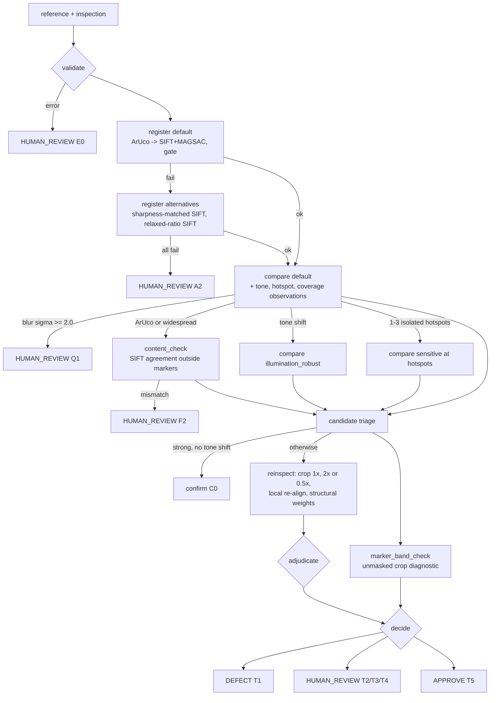

# D3: Adaptive perception-decision-action controller

`loopcheck/agent.py` is a transparent policy controller: no LLM, no learned model, no
external service. It runs the deterministic OpenCV 5 tools from D2/D2.1, observes their
numeric outputs, and picks **one** next tool from explicit rules. It ends with
`APPROVE`, `DEFECT` or `HUMAN_REVIEW` and a full trace.

All results below are **synthetic experiments**. Scores and thresholds are uncalibrated
decision rules tuned on a development split, **not probabilities**.

## Architecture

| Component | What it is |
|---|---|
| **State** (`AgentState`) | Registration attempts; alignment and masks; comparisons by variant; observations (tone, hotspots, coverage, sharpness, widespread, content, marker band); candidates with status and views; executed action keys; errors; trace |
| **Tools** | `register(variant)`, `compare(variant)`, `reinspect(candidate)`, `marker_band_check()`, `content_check()`. Each reuses D2/D2.1 functions (`register`, `align_and_mask`, `compare`, `marker_exclusion`) |
| **Policy** | `InspectionAgent.policy`: ordered rules; the first that holds returns one `Action` (with rule id, rationale and the observations used) or a `Termination` |
| **Executor** | `InspectionAgent.run`: budget (`max_steps` = 16), duplicate refusal, try/except around every tool and the policy, per-step trace |

## Safety properties (each covered by a test in `tests/test_agent.py`)

- **No error becomes APPROVE.** Each of these ends in HUMAN_REVIEW:
  - input error (`E0`)
  - policy exception (`X1`)
  - a duplicate action proposed (`X2`)
  - budget exhausted (`X3`)
  - any tool exception (`X4`)
  - all registration attempts failed (`A2`)

  A failing re-inspection view is never counted as "clean"; the candidate becomes AMBIGUOUS.
- **APPROVE requires all of:** reliable registration, inspected fraction ≥ 0.80 of
  the reference frame, no unresolved or ambiguous candidate, and no unexplained finding
  in the marker band. Every APPROVE lists its limitations: the sensitivity floor, and the
  excluded polygons if any.
- **Masked marker pixels are NOT INSPECTED.** Coverage reports observed, inspected and
  excluded fractions separately, and the excluded polygons appear in the report and on
  the overlay. The excluded band is screened by a separate unmasked diagnostic, and an
  unexplained finding there leads to HUMAN_REVIEW.
- **Marker alignment does not prove identity.** After ArUco registration, the content
  check matches SIFT features outside the markers between the reference and the
  aligned inspection.
- **Decreasing differences never approve by themselves.** A candidate is dismissed only
  when no re-inspection view reproduces it *and* a concrete explanation holds. Partial or
  conflicting evidence stays AMBIGUOUS, which leads to HUMAN_REVIEW.

## Branches

| Branch | Trigger (observation) | Action | Outcome logic |
|---|---|---|---|
| **A** poor registration | default registration fails the D2 quality gate | `register(sharpness_matched_sift)`: blur the sharper image to equal focus, SIFT at half resolution; then `register(relaxed_ratio_sift)`: ratio 0.85, 8000 features, no ArUco | Full-resolution sanity gate re-applied; all fail → HUMAN_REVIEW (`A2`) |
| **B** illumination shift | blurred conditional-median tone curve deviates ≥ 3.0 L from a line, or the linear gain is off by ≥ 0.12 | `compare(illumination_robust)`: quantile mapping and structure-weighted cues | New robust-only regions become candidates; all candidates are re-inspected (no "strong" shortcut under a tone shift) |
| **C** ambiguous candidate | any candidate not meeting the strong rule (peak ≥ 0.75, area ≥ 400 px, no tone shift) | `reinspect`, four views on a crop with context: crop-local tone fit at 1x; at 2x (tiny) or 0.5x (large); after local ECC translation re-alignment; and with structure weights | Confirm: structural view reproduces it at peak ≥ 0.70 *and* ≥ 1 other view agrees. Dismiss: zero reproduction *plus* an explanation (photometric cue under a measured tone shift and absent from the robust full-image view; or ≥ 0.5 px local misalignment). Otherwise AMBIGUOUS |
| **D** tiny / low-contrast | 1–3 isolated sub-threshold hotspots (map ≥ 0.20, peak ≥ 0.30, not on existing candidates) | `compare(sensitive)` (threshold 0.22, peak 0.33); only detections at the hotspots are kept; re-inspected **at the same sensitivity** | Not reproduced → dismissed. Reproduced → AMBIGUOUS → HUMAN_REVIEW, **never auto-DEFECT** (the mode's false-positive rate is high). More than 3 hotspots is logged as a global effect and the scan is skipped (`D0` note) |
| **E** marker blind spot | markers were excluded | `marker_band_check`: each band component is cropped with 24 px context and compared **without** the marker mask, with a crop-local tone fit | A finding at peak ≥ 0.60 that doesn't touch a confirmed defect → HUMAN_REVIEW (`T3`); coverage < 0.80 → HUMAN_REVIEW (`T4`) |
| **F** content / widespread | ArUco registration, or ≥ 6 regions, or ≥ 2% of pixels above threshold | `content_check`: SIFT matches between reference and aligned inspection outside markers; agreement = share at ≤ 4 px displacement | < 20 matches or agreement < 0.20 → HUMAN_REVIEW (`F2`); ≥ 30% of pixels flagged even after the robust comparison → HUMAN_REVIEW (`F3`) |
| **G** clean | none of the above remain | — | APPROVE (`T5`) |

There is also an image-quality gate (`Q1`): if the sharpness-equalisation sigma needed
is ≥ 2.0, the result is HUMAN_REVIEW.

## Trace

`report.json` (CLI `--agent`) holds:
- `decision`, `termination_rule`, `reasons`, `branches`;
- `registration` (all attempts), `coverage`, `excluded_polygons_reference`,
  `observations`;
- `candidates`, each with source, status, reason, box, first-pass evidence and every
  re-inspection view;
- `defects`, `resolution_counts`, `limitations`, `errors`.

Each entry in `steps` holds:
- `index`, `state_before` and `state_after`;
- `rule`, `tool` and `params`, `rationale`, `observations_used`;
- `output` or `error`;
- `effect` (what changed) and `seconds`.

`notes` records policy decisions that needed no tool, e.g. strong-candidate confirmation
(`C0`) or a skipped sensitive scan (`D0`). The terminal shows the same trace in readable
form.

## How the thresholds were set (dev split only)

- **Dev:** `data/synthetic/d3_dev`, seed 4100, 8 per type, 144 cases.
- **Test:** seed 4200, 10 per type, 180 cases. Generated only after the configuration was
  frozen and pushed (`0c5674e`), and evaluated once.

The case types are the 17 D2.1 types plus `gamma_missing` (a real missing part under a
gamma shift of up to ±0.30, i.e. conflicting evidence).

Development iterations, all on dev:
1. **First policy (untuned): worse than one-shot** (F1 0.880 vs 0.946). Three problems:
   - the illumination branch fired on 79/144 cases;
   - photometric false positives were "confirmed" by several crop views that share the
     same cause;
   - content agreement false alarms at threshold 0.35.
2. **Measured distributions:**
   - The original tone measure (quantile-pair linear fit) was confounded by blur, so it
     was replaced by the blurred conditional-median measure.
   - Content agreement: same tray 0.32–1.00, different tray 0.03–0.13, so the threshold
     moved to 0.20.
   - Across 143 re-inspected candidates (28 real), the **structure-weighted view**
     separated them: real candidates peaked mostly ≥ 0.72, false ones ≤ 0.63, so the
     confirmation peak is 0.70. The gap is narrow.
3. **Sensitive candidates** were re-checked at default sensitivity and could never
   reproduce. They are now re-checked at their own sensitivity, and reproduction leads
   to HUMAN_REVIEW.
4. **The first marker-band screen** (an SSIM contrast term) **missed an object touching
   the marker border**. It was replaced by the unmasked crop diagnostic:
   - it caught the object at 3, 6, 10 and 14 px offsets (peak ≥ 0.91);
   - real dev band objects peaked 0.71–0.97, false findings ≤ 0.67, so the threshold is 0.60.
5. **Illumination trigger:**
   - 3.0 / 0.12 fired on 25 dev cases with decisions identical to 6.0 / 0.20 (3 cases);
   - 2.5 / 0.10 added one escalation.

   3.0 / 0.12 was chosen so the branch actually runs on gamma cases. **On dev, B did
   not change any decision.**

## Results: one-shot D2.1 vs agent, same cases (SYNTHETIC)

Expectations were defined before evaluation (`loopcheck/evaluate_agent.py`):

| Category | Expected decision | Safe alternative | Notes |
|---|---|---|---|
| Good images | APPROVE | HUMAN_REVIEW | |
| Defects | DEFECT, with ≥ 1 ground-truth box at IoU ≥ 0.3 | HUMAN_REVIEW | |
| `subtle_foreign` | DEFECT or HUMAN_REVIEW | — | Ambiguous by design |
| Registration failures | HUMAN_REVIEW | — | |
| Different tray | HUMAN_REVIEW | DEFECT (wrong reason) | |

One-shot decisions are mapped mechanically: no regions → APPROVE, regions → DEFECT,
registration failure → HUMAN_REVIEW.

| Metric | Dev one-shot | Dev agent | **Test one-shot** | **Test agent** |
|---|---|---|---|---|
| Image-level precision / recall / F1 (DEFECT = positive) | 0.938 / 0.953 / 0.946 | 1.000 / 0.938 / 0.968 | 0.865 / 0.963 / 0.911 | **1.000 / 0.887 / 0.940** |
| Recall counting HUMAN_REVIEW as "not approved" | 0.953 | 0.984 | 0.963 | **1.000** |
| False-positive rate on good images (DEFECT) | 0.083 | 0.000 | 0.200 | **0.000** |
| Good images not auto-approved | 0.083 | 0.125 | 0.200 | **0.267** |
| Region recall @ IoU ≥ 0.3 (reported defect boxes) | 0.958 | 0.944 | 0.967 | **0.900** |
| Automatic decision coverage | 0.833 | 0.715 | 0.833 | **0.639** |
| Automatic decision accuracy | 0.875 | 0.990 | 0.833 | **1.000** |
| Errors among automatic decisions | 15 | 1 | 25 | **0** |
| HUMAN_REVIEW rate | 0.167 | 0.285 | 0.167 | **0.361** |
| Task success rate | 0.896 | 0.944 | 0.861 | **0.889** |
| Critical errors (APPROVE when not expected) | 3 | 1 | 3 | **0** |
| Latency mean / median / p90 (s, 4-core CPU, 800×600) | 0.38 / 0.34 / 0.54 | 0.66 / 0.56 / 0.91 | 0.37 / 0.33 / 0.54 | **0.67 / 0.57 / 1.02** |
| Tool calls per case, mean / max (one-shot = 2) | — | 4.06 / 12 | — | **4.44 / 12** |

**Test-split agent behaviour.** Raw data: `results/d3/test/{metrics.json, per_case.json,
summary.md, agent_traces.jsonl.gz}`.
- **Branch activations (cases):** A 30, B 39, C 39, D 43, E 86, F 101, G 44.
- **Termination rules:**

  | Rule | Meaning | Cases |
  |---|---|---|
  | T1 | DEFECT | 71 |
  | T5 | APPROVE | 44 |
  | A2 | registration failed | 24 |
  | T2 | unresolved candidates | 24 |
  | F2 | content mismatch | 10 |
  | Q1 | too blurred | 6 |
  | T3 | marker-band finding | 1 |

- **Ambiguity resolved vs escalated:**
  - 60 cases needed re-inspection: 33 ended DEFECT, 3 APPROVE, 24 HUMAN_REVIEW.
  - Re-inspected candidates: 31 confirmed, 34 dismissed with explanation, 91 left
    ambiguous.
  - 40 further candidates were confirmed on strong first-pass evidence.
- **Overhead:** 330 extra tool calls (beyond register + compare) were spent on the 155
  cases one-shot already decided correctly; that's the cost of verification (content
  checks, band screens, re-inspection).
- Tool errors: 0. Duplicate actions refused: 0. Budget exhaustions: 0.

### What changed, case by case (test)

- **Fixed:**
  - all 10 different-tray cases (one-shot: DEFECT for the wrong reason; agent:
    HUMAN_REVIEW via `F2`);
  - all 3 one-shot misses (two subtle objects, one foreign object). They are now
    HUMAN_REVIEW, with no defect approved;
  - 12 one-shot false alarms on good images. 11 became HUMAN_REVIEW and 1 became a
    correct APPROVE.
- **Cost:**
  - **7 of 10 `lighting` good images were escalated**, against 0 of 8 on dev.
    Ambiguous candidates on those images came mostly from the **targeted sensitive scan**
    (71 of 128 unresolved/ambiguous candidates on escalated good images): weak responses
    that reproduce at their own sensitivity are escalated by design. Dev did not predict
    this rate. A fix (e.g. requiring structural reproduction before a sensitive candidate
    can escalate) must be measured on a new split.
  - 3 real defects that one-shot localised correctly were escalated instead
    (`missing_near_marker_09`, `foreign_near_marker_09`, `gamma_missing_05`): their
    structural evidence fell below the 0.70 confirmation peak.
  - Strict recall (DEFECT only) drops 0.963 → 0.887, and region recall 0.967 → 0.900,
    because escalated cases report no defect boxes.
  - Latency rises about 1.8×.

## Limitations and open issues

- **Synthetic only.** All splits come from one generator, so real photographs will have
  different noise, lighting, parallax and materials. No real-image evaluation exists yet.
- **Review rate.** 36% of test cases go to HUMAN_REVIEW. 22% of all cases are *expected*
  HUMAN_REVIEW (registration failures and different trays); the rest is conservatism.
  The biggest contributor is branch D on good images under lighting changes.
- **Narrow margins.** The confirmation threshold (0.70) and band threshold (0.60) sit in
  narrow dev gaps (0.63–0.72 and 0.67–0.71).
- **Branch B** did not change any dev decision. Its value on test isn't isolated by an
  ablation; that's a candidate follow-up.
- **Sensitivity floor.** Defects below the sensitive scan's floor, or among more than 3
  hotspots (scan skipped), can still be approved. On dev, 1 subtle defect was approved;
  on test, 0.
- **Content check.** It needs SIFT texture outside the markers. Featureless trays would
  give few matches and lead to HUMAN_REVIEW (`F2`), which is safe but not useful.
- **No ECC in the main path** (as in D2); local ECC is used only as a translation
  re-alignment view during re-inspection.
EOF