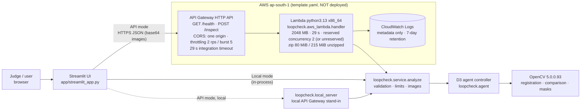

# D4 / D4.1: Demo interface, AWS backend and deployment runbook

**Deployment status (2026-10-23): NOT deployed.** No AWS resource has been created,
modified or deleted, no artifact has been uploaded, and there is no public URL. The backend
and this runbook are prepared and verified locally (see [Verification](#what-was-verified-locally)).
**You** run the deployment from your own machine with the AWS profile `loopcheck` in
`ap-south-1` (Mumbai).

All metrics and bundled cases are **synthetic**. Anomaly scores are uncalibrated heuristics,
**not probabilities**. Excluded marker areas are **not inspected** and are never shown as clean.

## Architecture



There is one code path. The Lambda handler, the local API server and the Streamlit local
mode all call `loopcheck.service.analyze`, which validates input and runs the real D3
controller (`InspectionAgent`) on OpenCV 5.

## Request flow (`POST /inspect`)

1. **Client.** Sends `{"reference_b64": str, "inspection_b64": str, "options": {"include_images": bool}}`.
   PNG or JPEG only; data-URL prefixes are tolerated.
2. **API Gateway HTTP API.** Applies throttling (2 requests/s, burst 5) and CORS, then
   invokes Lambda with payload format 2.0. The body may arrive with `isBase64Encoded`.
3. **Handler** (`loopcheck/aws_lambda.py`). Checks route and method, body size and encoding,
   and the JSON shape; unknown fields are rejected.
4. **Service.** Checks each image:
   - size ≤ **2 MB**, checked before decoding;
   - PNG/JPEG magic bytes;
   - OpenCV can decode it;
   - side ≤ **4096 px**;
   - D2 validation (minimum size, not blank, channels).
5. **Controller.** Registers, compares, picks tools adaptively, decides, and records the trace.
6. **Rendering.** Overlay, aligned image and heatmap as JPEG ≤ 1024 px. Masked and
   unobserved pixels are darkened with a magenta outline.
7. **Response.** Decision, rule, reasons, disclaimer, runtime (OpenCV version and seconds),
   the full agent report and images. Images are dropped if the JSON would exceed 5.5 MB.

### Responses and errors

| Status | Meaning |
|---|---|
| 200 | Analysed. `decision` is `APPROVE`, `DEFECT` or `HUMAN_REVIEW` |
| 400 | Invalid JSON, encoding, fields, options or base64 |
| 404 / 405 | Unknown route or wrong method |
| 413 | Image or body too large, or dimensions too large |
| 415 | Not PNG or JPEG |
| 422 | Not decodable, too small, or blank |
| 500 | Unexpected error. The body carries only the exception type |

**Every non-200 body carries `"decision": "HUMAN_REVIEW"`.** Internal failures inside the
controller (rules `X0`–`X4`) return 200 with `HUMAN_REVIEW`. Over the public API their
tracebacks and exception messages are stripped (`service.publicize`); errors keep only
`{"where", "type"}`. No failure path produces `APPROVE`; tests cover this.

## Security and cost controls (D4.1 hardening)

| Control | Setting | Notes |
|---|---|---|
| API throttling | 2 requests/s, burst 5 (`ThrottleRatePerSecond`, `ThrottleBurst`) | Applies to all routes |
| Lambda concurrency | `ConcurrencyMode=reserved` (default): `ReservedConcurrentExecutions: 2`. `ConcurrencyMode=unreserved`: the property is **omitted** | See [Concurrency modes](#concurrency-modes-reserved-vs-unreserved). There is deliberately no numeric option: **reserved concurrency 0 is Lambda's off switch** (every invocation is throttled) and must never be used for this endpoint. |
| Upload limits | 2 MB per image, ≤ 4096 px per side, body ≤ about 5.3 MB | Within Lambda's 6 MB synchronous payload limit |
| CORS | Exactly one origin (`AllowedOrigin`); the template's `AllowedPattern` rejects `*`, wildcards and paths | **CORS is not authentication.** It only restricts which web pages can call the API from a browser; `curl` or any server can still call the public endpoint. The Streamlit app calls the API from its Python server process, so CORS does not apply to it. |
| IAM | No `Policies`, no custom `Role` | SAM attaches only `AWSLambdaBasicExecutionRole` (write its own logs). No S3, database, secrets or VPC access. |
| Logging | One JSON metadata line per request: route, method, status, decision, rule, byte counts, latency, error code, exception **type** and code location | **Never logged:** request bodies, base64 or decoded images, exception messages, headers, environment variables, credentials. Enforced by tests (`tests/test_deploy.py`). |
| Log retention | 7 days (`LogRetentionDays`) | The log group is part of the stack and is deleted with it |
| Runtime check | `import loopcheck` raises unless OpenCV is 5.x; cold-start log `{"event": "cold_start", "opencv_version": ...}` | `/health` reports the version |
| Services | API Gateway HTTP API, Lambda, CloudWatch Logs (plus SAM's artifact bucket during deploy) | No ECR, NAT, VPC, database or CloudFront |

### Concurrency modes: reserved vs unreserved

| | `ConcurrencyMode=reserved` (default, recommended when supported) | `ConcurrencyMode=unreserved` (fallback) |
|---|---|---|
| Template effect | `ReservedConcurrentExecutions: 2` | Property omitted (`AWS::NoValue`); no reservation exists |
| Per-function cap | At most 2 copies run at once. Extra concurrent requests are throttled by Lambda, so API Gateway returns 5xx | None. The function can scale up to the account's shared unreserved pool |
| Guarantee | 2 executions are set aside for this function. Other functions cannot use them | None. Other functions in the account compete for the same pool |
| Effect on other workloads | The account's shared pool shrinks by 2 | None at rest; under load it consumes from the shared pool |
| AWS constraint | AWS rejects the reservation if fewer than 10 unreserved executions would remain. Accounts whose total limit is 10 (many new accounts) cannot reserve 2 | Always accepted |
| Cost guard | API Gateway throttling (2 req/s, burst 5) **plus** the 2-copy cap | API Gateway throttling (2 req/s, burst 5) **only** |

In both modes, API Gateway throttling is identical and is the primary request-rate guard.
`deploy/preflight.sh` reads the account limits (read-only) and prints the mode to use. If
the stack already exists, it counts the function's current reservation back in.

**Never set reserved concurrency to 0 to "fix" a rejected reservation.** The deployment
would succeed, but every request would be throttled. Use `ConcurrencyMode=unreserved`
instead.

> **Throttling and reserved concurrency reduce cost risk but cannot guarantee a fixed
> maximum bill.** The endpoint is public and unauthenticated. Requests rejected by
> throttling are not billed as invocations, but accepted traffic, retries, log ingestion,
> S3 storage and data transfer all accrue charges. Worst case at the throttle limit is
> about 2 req/s × 86,400 s ≈ 170k requests/day.
>
> Mitigations:
> - Deploy only for the judging window, then delete the stack (step 10).
> - Optionally create an AWS Budgets alert in the console. A budget only notifies you; it
>   does not stop spending.

## Packaging and the `sam build` pitfall

`bash deploy/build_lambda_zip.sh` installs the exact cp313 manylinux_2_28 x86_64 wheels
(`opencv-contrib-python-headless==5.0.0.93`, `numpy==2.5.4`, as in `uv.lock`), adds
`loopcheck/`, and writes **`deploy/.build/loopcheck-lambda-x86_64.zip`** (80 MiB; 215 MiB
unzipped against Lambda's 250 MiB limit). It runs on Linux and macOS; see runbook step 4a.

Before the zip is moved into place, `deploy/lambda_package.py verify` checks:
- archive integrity (CRC);
- that `cv2/cv2.abi3.so` and numpy's `_multiarray_umath…cpython-313-x86_64-linux-gnu.so`
  are inside;
- that both are **64-bit Linux ELF for x86-64** (Mach-O, aarch64 or non-ELF are rejected);
- the distribution versions against `deploy/requirements-lambda.txt`, with OpenCV 5.x and
  no other OpenCV distribution;
- manylinux x86_64 wheel tags;
- no `__pycache__` or macOS junk;
- the 250 MiB limit.

On Linux x86_64 with Python 3.13, it also extracts the zip, imports it with an isolated
interpreter (OpenCV must be 5.x) and calls `GET /health`. Any failure removes the
archive.

`template.yaml` uses that **zip** as `CodeUri`. Do not change it to the unpacked folder.
With SAM CLI 1.170.0, `sam build` on a folder `CodeUri` ran the Python builder, which
excludes `*.so`, `*.dist-info` and `__pycache__` from source folders. It silently dropped
128 of 431 files, including `cv2.abi3.so` itself, which would have broken the function at
import. With a `.zip` `CodeUri`, `sam build` passes the archive through unchanged (verified:
the built template references the same zip, same sha256), and `sam deploy` uploads it to S3
as-is.

The alternative container path (`deploy/Dockerfile`) is not used and was not built.

## Runbook: deploy from your own machine

**Legend:**
- 🟢 **LOCAL:** runs on your machine; no AWS calls, or read-only AWS calls only. Free.
- 🔴 **BILLABLE:** creates or changes AWS resources, or uploads artifacts.

Never paste credentials into chat, into this repository or into any file in it.
Authenticate only through the AWS CLI's own credential store or SSO (step 2). Every command
passes `--profile loopcheck --region ap-south-1` explicitly.

Run these from the repository root:

```bash
export AWS_PROFILE_NAME=loopcheck REGION=ap-south-1 STACK=loopcheck-demo
export SAM_CLI_TELEMETRY=0 AWS_PAGER=""
```

### 1. Install and verify the AWS CLI and SAM CLI 🟢

- **AWS CLI v2:** use the official installer for your OS:
  https://docs.aws.amazon.com/cli/latest/userguide/getting-started-install.html
- **SAM CLI:** use the official installer
  (https://docs.aws.amazon.com/serverless-application-model/latest/developerguide/install-sam-cli.html),
  or:

```bash
uv tool install aws-sam-cli
aws --version          # expect aws-cli/2.x
sam --version          # verified with SAM CLI 1.170.0
uv --version           # needed by the build script
```

### 2. Authenticate locally with profile `loopcheck` 🟢

Prefer IAM Identity Center (SSO) or another short-lived credential. The CLI stores the
result in `~/.aws/`, outside the repository:

```bash
aws configure sso --profile loopcheck      # interactive; choose the account, a deploy-capable role, region ap-south-1
aws sso login --profile loopcheck          # when the session expires
# (if you must use long-lived access keys: aws configure --profile loopcheck — and enter them only at the CLI prompt)
```

If `AWS_ACCESS_KEY_ID`, `AWS_SECRET_ACCESS_KEY` or `AWS_SESSION_TOKEN` are set in your
shell, unset them so it is unambiguous which identity is used:
`unset AWS_ACCESS_KEY_ID AWS_SECRET_ACCESS_KEY AWS_SESSION_TOKEN`.

### 3. Verify identity and region 🟢 (read-only)

```bash
aws sts get-caller-identity --profile "$AWS_PROFILE_NAME" --region "$REGION" --query '[Account,Arn]' --output text
```

**Confirm that the printed account ID is the one you intend to use before continuing.**

### 4. Build, validate and preflight 🟢 (local; the preflight's AWS calls are read-only)

Run these in order, and **stop at the first failure**:

```bash
bash deploy/build_lambda_zip.sh        # 4a: must end with "== done: .../loopcheck-lambda-x86_64.zip" and a sha256
sam validate --lint --template template.yaml --region "$REGION" --profile "$AWS_PROFILE_NAME"   # 4b: must print "... is a valid SAM Template"
sam build --template template.yaml     # 4c: "Build Succeeded"; passes the verified zip through unchanged
bash deploy/preflight.sh               # 4d: read-only; must end with "RESULT: PASS"
```

**4a: the build works on Linux and macOS** (bash 3.2+). All size, hash and zip work is
done by `deploy/lambda_package.py` (Python standard library), so GNU `du -b`, `stat -c`
and `sha256sum` are no longer needed.
- **Helper interpreter:** any `python3` ≥ 3.8 runs it, macOS's system Python included.
  Set `PYTHON=/path/to/python3` to choose another.
- **What gets packaged:** uv always installs the **Linux** wheels for Lambda (cp313,
  `manylinux_2_28_x86_64`), never macOS wheels.
- **Checks before the zip exists:** the archive is written under a temporary name and
  verified first. Verification covers:
  - CRCs and the required OpenCV 5 and NumPy compiled files;
  - that those files are **Linux ELF x86-64** (a macOS Mach-O binary fails the build);
  - pinned versions, no conflicting OpenCV, and the 250 MiB limit.
- **On failure:** the script prints `BUILD FAILED` and leaves **no** zip, so a later
  preflight can't mistake an old or partial archive for a good one.
- **Import smoke test:** it extracts the zip, imports it in isolation and calls
  `GET /health`. It needs Linux x86_64 with Python 3.13; on macOS it prints
  `SKIPPED import smoke test`, which is expected. The structural checks above still run,
  and step 7 proves the import on AWS itself.

**4b/4d: SAM output.** Validation passes only if `sam validate` exits 0 **and** prints
`… is a valid SAM Template` on stdout. If a newer SAM CLI exists, SAM also prints
`SAM CLI update available … / To download: https://docs.aws.amazon.com/serverless-application-model/…`
on **stderr**. That notice is informational and is not the validation result. The
preflight shows the validation line itself and lists the notice separately as `(info)`.
A real failure exits 1 with lint errors (for example `Error: Linting failed …`), and the
preflight reports it as `FAIL`.

**4c:** `sam build` writes `.aws-sam/build/template.yaml` (git-ignored). On some SAM
versions it requires `python3.13` on PATH: run `uv python install 3.13`, then confirm with
`python3.13 --version`. As a fallback you can skip `sam build` and pass
`--template-file template.yaml` to `sam deploy`; that deploys the same zip.

**4d: `deploy/preflight.sh`** makes read-only AWS calls only:
- `sts get-caller-identity`, `lambda get-account-settings`;
- `lambda get-function-concurrency` (only if the stack exists);
- `cloudformation describe-stacks` and `describe-stack-resource`;
- `sam validate --lint`.

It never prints credentials, only the *names* of any credential variables set in your
shell. It checks:
- the tools and the profile;
- the identity, account and region;
- which concurrency mode your account supports, printed as
  `RECOMMENDED: ... ConcurrencyMode=reserved` or `ConcurrencyMode=unreserved`;
- whether the stack or SAM's managed bucket already exist;
- the zip, using the same portable verifier as the build, plus a check that the packaged
  code matches the source.

**`sam deploy` prefers `.aws-sam/build/template.yaml` whenever it exists.** After pulling
any change to `template.yaml`, re-run `sam build`, or delete `.aws-sam/`. Otherwise a stale
build of an older template will be deployed.

### 5. Deploy stack `loopcheck-demo` to ap-south-1 🔴 BILLABLE

This creates:
- SAM's managed artifact stack and private S3 bucket, if they don't exist in ap-south-1
  yet (`--resolve-s3`). The 80 MiB zip is uploaded under the prefix `loopcheck-demo/`.
- The stack `loopcheck-demo`: the Lambda function and its logging-only role, the HTTP API
  (stage, 2 routes, integration, invoke permissions) and the log group.

SAM shows a change set and asks for confirmation before creating anything. Run **one** of
the two commands, using the mode the preflight printed (`RECOMMENDED: ... ConcurrencyMode=...`).

**5a. Reserved mode (default; preflight printed `ConcurrencyMode=reserved`).** The function
gets `ReservedConcurrentExecutions: 2`.

```bash
sam deploy \
  --stack-name "$STACK" --region "$REGION" --profile "$AWS_PROFILE_NAME" \
  --resolve-s3 --s3-prefix "$STACK" \
  --capabilities CAPABILITY_IAM \
  --confirm-changeset \
  --parameter-overrides AllowedOrigin=http://localhost:8501 ConcurrencyMode=reserved ThrottleRatePerSecond=2 ThrottleBurst=5 \
  --tags project=loopcheck purpose=opencv-competition-demo
```

**5b. Unreserved mode (preflight printed `ConcurrencyMode=unreserved`, e.g. an account
limit of 10).** `ReservedConcurrentExecutions` is omitted and API Gateway throttling still
applies.

```bash
sam deploy \
  --stack-name "$STACK" --region "$REGION" --profile "$AWS_PROFILE_NAME" \
  --resolve-s3 --s3-prefix "$STACK" \
  --capabilities CAPABILITY_IAM \
  --confirm-changeset \
  --parameter-overrides AllowedOrigin=http://localhost:8501 ConcurrencyMode=unreserved ThrottleRatePerSecond=2 ThrottleBurst=5 \
  --tags project=loopcheck purpose=opencv-competition-demo
```

- **Check the change set before confirming.** For 5a it shows
  `ReservedConcurrentExecutions: 2` on the function; for 5b the property is absent. After
  deployment, verify read-only with:
  `aws lambda get-function-concurrency --function-name "$(aws cloudformation describe-stack-resource --stack-name "$STACK" --logical-resource-id InspectFunction --query StackResourceDetail.PhysicalResourceId --output text --region "$REGION" --profile "$AWS_PROFILE_NAME")" --region "$REGION" --profile "$AWS_PROFILE_NAME"`.
  It prints `{"ReservedConcurrentExecutions": 2}` in reserved mode and `{}` in unreserved mode.
- **Never use reserved concurrency 0** (in the template, the console or
  `put-function-concurrency`). It is Lambda's off switch and throttles every request.
- If the UI will be hosted somewhere other than localhost, set `AllowedOrigin` to its exact
  origin, e.g. `https://my-ui.example.com`.

### 6. Retrieve the endpoint and test `/health` and `/inspect` 🔴

These calls hit the deployed API and are billed per request: a few cents at most.

```bash
API=$(aws cloudformation describe-stacks --stack-name "$STACK" --region "$REGION" --profile "$AWS_PROFILE_NAME" \
      --query "Stacks[0].Outputs[?OutputKey=='ApiUrl'].OutputValue" --output text)
echo "$API"
curl -s "$API/health"                               # expect "status": "ok", "opencv_version": "5.0.0"
uv run --frozen python -m loopcheck.client --url "$API" --case data/demo_cases/02_missing_part --expect DEFECT
uv run --frozen python -m loopcheck.client --url "$API" --case data/demo_cases/01_clean --expect APPROVE
uv run --frozen python -m loopcheck.client --url "$API" --case data/demo_cases/08_registration_failure --expect HUMAN_REVIEW
```

### 7. Verify that OpenCV 5 and the agent actually ran on AWS 🟢 (reading responses and logs)

`loopcheck.client` prints, and checks:
- `health_opencv_version` and `inspect_opencv_version`, both from the Lambda runtime and
  expected to be `5.0.0`;
- `agent_tool_sequence`, e.g. `["R0:register", "R1:compare", …]`, which shows the D3
  controller's steps;
- `decision`, `termination_rule`, `server_seconds` and `wall_seconds`.

It ends with `SMOKE TEST: PASS` only if:
- health is ok;
- the reported OpenCV is 5.x;
- the agent made tool calls;
- no error occurred;
- the decision matches `--expect`.

The Lambda cold-start log line `{"event": "cold_start", "opencv_version": "5.0.0"}` (step 9)
is independent evidence.

**Record these outputs as deployment evidence.** Until you run them, no AWS execution has
been demonstrated.

### 8. Configure Streamlit to use the deployed API 🟢 (UI runs locally; calls are billed per request)

```bash
uv sync --frozen --group demo
LOOPCHECK_API_URL="$API" uv run --frozen --group demo streamlit run app/streamlit_app.py
# in the sidebar choose "HTTP API", press "Check API health", then run a bundled case
```

### 9. Check logs safely 🟢 (read-only; CloudWatch Logs reads are billed per GB scanned, negligible)

```bash
aws logs tail "/aws/lambda/$STACK-inspect" --since 30m --region "$REGION" --profile "$AWS_PROFILE_NAME"
aws logs tail "/aws/lambda/$STACK-inspect" --since 30m --filter-pattern '"cold_start"' --region "$REGION" --profile "$AWS_PROFILE_NAME"
```

The log lines contain only request metadata, never images, bodies or credentials.
Platform lines (`START`, `END`, `REPORT` with duration and memory) come from Lambda itself.

### 10. Delete only the project's resources 🔴 (stops further charges from the stack)

```bash
sam delete --stack-name "$STACK" --region "$REGION" --profile "$AWS_PROFILE_NAME"
# confirm the prompts; this deletes the function, role, HTTP API, log group and the artifacts SAM uploaded for this stack
aws cloudformation describe-stacks --stack-name "$STACK" --region "$REGION" --profile "$AWS_PROFILE_NAME" 2>&1 | tail -1   # expect "does not exist"
aws logs describe-log-groups --log-group-name-prefix "/aws/lambda/$STACK" --region "$REGION" --profile "$AWS_PROFILE_NAME" --query 'logGroups[].logGroupName'   # expect []
```

**The SAM artifact bucket is shared and can persist.** `sam deploy --resolve-s3` uses a
bucket owned by the CloudFormation stack `aws-sam-cli-managed-default`. That stack is
shared by **every** SAM project in the account and region, and `sam delete` does **not**
remove it. **Never delete that stack or bucket blindly.** To check what is left for *this*
project only:

```bash
BUCKET=$(aws cloudformation describe-stack-resource --stack-name aws-sam-cli-managed-default \
         --logical-resource-id SamCliSourceBucket --region "$REGION" --profile "$AWS_PROFILE_NAME" \
         --query StackResourceDetail.PhysicalResourceId --output text)
aws s3 ls "s3://$BUCKET/$STACK/" --recursive --region "$REGION" --profile "$AWS_PROFILE_NAME"   # read-only listing
# only if the listing shows leftover LoopCheck artifacts and nothing else under that prefix:
# aws s3 rm "s3://$BUCKET/$STACK/" --recursive --region "$REGION" --profile "$AWS_PROFILE_NAME"
```

Delete the whole `aws-sam-cli-managed-default` stack only if you have confirmed that no
other SAM project in ap-south-1 uses it. If the bucket is versioned, removing objects
leaves noncurrent versions until they are expired.

## Cost drivers

These are estimates, not measurements; use the AWS Pricing Calculator for ap-south-1.

| Item | What drives it | Short judging demo |
|---|---|---|
| Lambda | Requests, plus GB-seconds (2 GB × ~1–3 s per request including cold start ≈ 2–6 GB-s) | Within the free tier if the account has it; otherwise cents |
| API Gateway HTTP API | Per request | Negligible at demo volume |
| CloudWatch Logs | Ingestion and storage; 7-day retention | Negligible |
| S3 (SAM artifact bucket) | About 80 MiB per deployment, plus PUTs | Cents per month; **persists after `sam delete`** unless removed as above |
| Data transfer out | Responses of 0.1–0.3 MB | Negligible |

## What was verified locally

| Check | Result |
|---|---|
| Test suite | All pass (`uv run --frozen --group demo pytest -q`), including `tests/test_deploy.py`: template configuration, logging protections, public-response sanitisation, offline preflight with fake `aws`/`sam` recording every call |
| D1 OpenCV 5 verification | 9/9 pass (OpenCV 5.0.0) |
| Lambda zip | Built without Docker by the portable script: 215 MiB unzipped, 80 MiB zip, 325 file entries. `verify`: PASS (Linux ELF x86-64 `cv2.abi3.so` and numpy `…cpython-313-x86_64-linux-gnu.so`, opencv-contrib-python-headless 5.0.0.93, numpy 2.5.4). Extracted and imported in isolation: OpenCV 5.0.0, `/health` 200. `/inspect` from the extracted zip: DEFECT T1 (missing part), APPROVE T5 (clean), HUMAN_REVIEW T2 (ambiguous tiny), HUMAN_REVIEW A2 (registration failure) |
| macOS portability | Not run on a Mac. Simulated with BSD-behaving `du` (rejects `-b`) and `stat` (rejects `-c`) and no `sha256sum` on PATH: the **old** script reproduced the reported `du: invalid option -- b` and left no zip; the **new** script builds and verifies successfully (also an automated test). A wrong-platform install (Mach-O binaries) and a failed `uv` install both end with `BUILD FAILED` and no zip, and a stale zip from an earlier build is removed |
| Logs from the packaged handler | Metadata-only JSON lines; no base64 found |
| SAM CLI 1.170.0 (run locally with AWS credential variables removed) | `sam validate --lint`: valid. `sam build`: succeeded and passes the zip through (same sha256). The folder-`CodeUri` pitfall was found here and fixed. Exit codes observed: valid template → 0 plus `… is a valid SAM Template` on stdout; unknown `!Ref` or broken YAML → 1. The `To download: …` text is SAM's update notice on stderr (`samcli/lib/utils/version_checker.py`), not a validation result |
| Preflight script | Syntax OK. Without an AWS CLI it stops with `RESULT: FAIL` and creates nothing. With fake CLIs (tests) it passes; prints account and region; recommends the concurrency mode; stops on invalid identity; shows the `is a valid SAM Template` line (never the update notice) as the result; reports SAM lint failures and "exit 0 without a valid line" as FAIL; fails on a missing zip or a zip with macOS, OpenCV 4 or missing binaries; and only ever issues the read-only calls listed above |
| Local API stand-in | `python -m loopcheck.client --url http://127.0.0.1:8011 --expect DEFECT` → `SMOKE TEST: PASS` |
| AWS | **Nothing executed on AWS.** The sandbox credentials are invalid (STS `InvalidClientTokenId`, D4) and were not used or repaired |

## Blockers before you deploy

1. **Valid credentials for profile `loopcheck` on your machine** (step 2), with permission
   to create CloudFormation stacks, Lambda functions, IAM roles (`CAPABILITY_IAM`), HTTP
   APIs, log groups, and S3 objects in SAM's bucket.
2. **AWS CLI v2 and SAM CLI installed locally** (step 1).
3. **Your review of the change set** that `sam deploy --confirm-changeset` shows.
4. **If the preflight reports that reserving 2 is not possible** (e.g. an account
   concurrency limit of 10), deploy with `ConcurrencyMode=unreserved` (step 5b). The
   reservation is omitted, never set to 0.

## Limitations

- **Synthetic validation only.** No real-photograph evaluation exists. Bundled cases are
  illustrative selections from seed 5000 (the selection rule is in each `meta.json`).
  Aggregate held-out metrics, including the agent's 36% HUMAN_REVIEW rate, are in
  `docs/d3_agent.md`.
- **Lambda behaviour is unmeasured.** Cold start, memory headroom and latency on AWS have
  not been observed.
- **Packaging headroom.** The zip has about 35 MiB of headroom under the 250 MiB limit.
- **The Streamlit UI is not hosted on AWS.** It runs locally, or on any Streamlit host,
  and calls the API.
- **The endpoint is public and unauthenticated by decision**, for temporary judging use.
  Add a JWT or IAM authorizer before any longer exposure.
