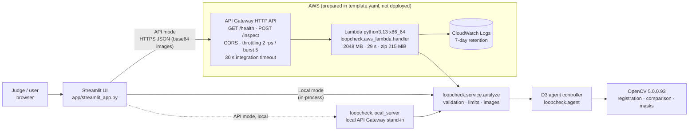

# D4: Demo interface and AWS backend (prepared, NOT deployed)

**Deployment status (verified 2026-10-23): nothing has been provisioned on AWS.** There is
no public URL. The backend is fully prepared and was verified locally (see
[Verification](#what-was-verified-locally)), but deployment is blocked; see
[Blockers](#blockers).

All metrics and bundled cases are **synthetic**. Anomaly scores are uncalibrated heuristics,
**not probabilities**. Excluded marker areas are **not inspected** and are never shown as clean.

## Architecture



There is one code path. The Lambda handler, the local API server and the Streamlit local
mode all call `loopcheck.service.analyze`, which validates input and runs the real D3
controller (`InspectionAgent`) on OpenCV 5.

## Request flow (`POST /inspect`)

1. **Client.** The Streamlit UI (or any HTTP client, `loopcheck/client.py`) sends JSON:
   `{"reference_b64": str, "inspection_b64": str, "options": {"include_images": bool}}`.
   PNG or JPEG only; data-URL prefixes are tolerated.
2. **API Gateway HTTP API** applies throttling and CORS, then invokes Lambda with payload
   format 2.0. A binary-safe body may arrive with `isBase64Encoded`.
3. **The handler** checks route and method, the body size, the body encoding and the JSON
   shape (unknown fields are rejected).
4. **The service** checks each image:
   - size ≤ 2 MB;
   - magic bytes say PNG or JPEG;
   - OpenCV can decode it;
   - side ≤ 4096 px;
   - D2 validation passes (minimum size, not blank, channels).
5. **The controller** runs: register, then compare, then adaptive tool choice, then a
   decision with a trace.
6. **The service** renders the overlay (inspection image), the aligned inspection and the
   heatmap. Masked and unobserved pixels are darkened with a magenta outline, never shown
   as clean. These are returned as JPEG ≤ 1024 px.
7. **Response:**
   - `decision`, `termination_rule`, `reasons` and the `disclaimer`;
   - `runtime` (OpenCV version and seconds);
   - the full agent `report`: steps, observations, candidates and every re-inspection
     view, coverage, excluded polygons, limitations and errors;
   - `images`.

   If the JSON would exceed 5.5 MB, the images are dropped and `images_omitted` explains why.

### Payload limits

| Limit | Value | Reason |
|---|---|---|
| Image size | 2 MB raw each (≈ 2.67 MB base64) | Two images plus JSON must stay under Lambda's 6 MB synchronous request payload (HTTP API allows 10 MB) |
| Image side | ≤ 4096 px | Processing uses ≤ 1024 px anyway; bounds memory |
| Response size | ≤ 5.5 MB (images dropped beyond) | Lambda's 6 MB response cap. Measured responses: 85–253 KiB |
| Timeout | Lambda 29 s, integration 29 s | HTTP API's 30 s ceiling. Measured: 0.3–0.7 s warm locally; Lambda timings unmeasured |

### Responses and errors

| Status | When |
|---|---|
| 200 | Analysed. `decision` is `APPROVE`, `DEFECT` or `HUMAN_REVIEW` |
| 400 | Invalid JSON, body encoding, fields, options or base64 |
| 404 / 405 | Unknown route or wrong method |
| 413 | Body or image too large, or image dimensions too large |
| 415 | Not PNG or JPEG |
| 422 | Not decodable, too small, or blank |
| 500 | Unexpected error. Only the exception type is returned; the traceback goes to CloudWatch |

**Every non-200 body carries `"decision": "HUMAN_REVIEW"` plus an `error` object.** An
exception inside the controller returns 200 with `HUMAN_REVIEW` (rule `X0`). No failure
path produces `APPROVE`; this is covered by tests.

## Security

- **Least privilege.** The function has no extra IAM policies, only SAM's
  `AWSLambdaBasicExecutionRole` (write its own CloudWatch logs). It uses no S3, database,
  secrets or network calls.
- **No secrets** in code, the template, the environment example or responses. A test puts
  a dummy secret into the environment and asserts it never appears in any response body.
- **Public, unauthenticated, throttled endpoint.** Throttling is 2 requests/s with a burst
  of 5 (parameterised). Reserved concurrency is optional; AWS refuses it if it would leave
  less than 10 unreserved executions. This is acceptable for a short judging window; for
  longer exposure, add a JWT/IAM authorizer.
- **CORS** allows only the configured `AllowedOrigin` (default `http://localhost:8501`).
  Note that the Streamlit UI calls the API from its Python server process, so CORS does
  not apply to it; CORS only restricts browser-side callers.
- **Input hardening.** Size checks happen before decoding, there is a format allow-list,
  dimension and blank checks, and unknown JSON fields are rejected. 500 errors expose no
  internals.
- **Runtime verification.** Importing `loopcheck` raises `ImportError` unless
  `cv2.__version__` starts with `5.`; the handler checks again at cold start. `/health`
  reports the version.

## Packaging

**Zip (chosen, no Docker needed).** `bash deploy/build_lambda_zip.sh` installs the exact
cp313 manylinux_2_28 x86_64 wheels from `deploy/requirements-lambda.txt`
(`opencv-contrib-python-headless==5.0.0.93`, `numpy==2.5.4`, matching `uv.lock`), copies
`loopcheck/` and prunes tests and type stubs. Measured:
- **Unzipped 215 MiB.** The Lambda limit is 250 MiB, so the margin is about 35 MiB.
- **Zip 80 MiB.** That is above the 50 MiB direct-upload limit, so it is deployed via S3;
  `sam deploy --resolve-s3` handles this.

**Container image (alternative, not built).** `deploy/Dockerfile` uses
`public.ecr.aws/lambda/python:3.13`. Use it if dependencies grow past the zip limit. It
needs a Docker daemon, which was not available on the build host, plus an ECR repository.

**Architecture.** x86_64 is the default because those wheels were import-verified on this
x86_64 host. `ARCH=arm64` builds aarch64 wheels (published for 5.0.0.93), but they could
not be verified here.

The template passes `cfn-lint` with no findings.

## What was verified locally

| Check | Result |
|---|---|
| D1 OpenCV 5 smoke tests | 9/9 pass (OpenCV 5.0.0) |
| Test suite | 142 pass: 97 earlier, 39 service/handler/server/client, 6 Streamlit AppTest |
| Earlier results | D2/D2.1 committed results byte-unchanged; the D3 held-out evaluation re-run reproduces all 180 cases exactly |
| Lambda package | Built without Docker. Imported with an isolated interpreter from the package directory: OpenCV 5.0.0 / numpy 2.5.4; `/health` 200; `/inspect` returns DEFECT / APPROVE / HUMAN_REVIEW on bundled cases (0.3–0.6 s, responses 85–253 KiB) |
| Live UI (Streamlit server + headless Chromium) | Local mode: "Defect next to an ArUco marker" → DEFECT T1. API mode through `loopcheck.local_server` (the same handler code): "Different tray" → HUMAN_REVIEW F2. No page errors. Screenshots in `docs/img/d4_ui_*.jpg` |
| AppTest over all 8 bundled cases | Every case's decision matches the one recorded when it was selected |
| SAM template | `cfn-lint`: no findings |
| AWS account | **Not verified.** STS `GetCallerIdentity` returned `InvalidClientTokenId` |

## Deployment plan (awaiting approval; nothing has been created)

**Region:** to be chosen by you. **Stack:** `loopcheck-demo`.

**Resources that `sam deploy` would create:**
1. **A SAM-managed artifact bucket**, via the CloudFormation stack
   `aws-sam-cli-managed-default` (an S3 bucket, private, created once per account and
   region if it doesn't exist). It would hold the 80 MiB zip.
2. **The stack `loopcheck-demo`**, containing:
   - a Lambda function;
   - its IAM execution role (basic logging only);
   - an HTTP API with a `$default` stage, 2 routes, an integration and Lambda invoke
     permissions;
   - a CloudWatch log group (7-day retention).

There is no ECR, no database, no NAT and no VPC.

**Commands.** Run these from a machine with valid credentials, or from this sandbox once
the credentials are fixed:

```bash
# tools (one-time)
uv tool install aws-sam-cli            # or: pip install aws-sam-cli ; AWS CLI v2 is optional
# build + validate
bash deploy/build_lambda_zip.sh
sam validate --lint
# deploy (shows a change set and asks for confirmation)
cp deploy/samconfig.example.toml samconfig.toml   # set region
sam deploy --region <region> --guided
# smoke test
API=$(aws cloudformation describe-stacks --stack-name loopcheck-demo --region <region> \
      --query "Stacks[0].Outputs[?OutputKey=='ApiUrl'].OutputValue" --output text)
curl -s "$API/health"
# point the UI at it
LOOPCHECK_API_URL="$API" uv run --frozen --group demo streamlit run app/streamlit_app.py
```

**Cleanup:**

```bash
sam delete --stack-name loopcheck-demo --region <region>
```

This deletes the function, role, API and log group, and SAM's uploaded artifacts for this
stack. The `aws-sam-cli-managed-default` bucket and stack are shared by all SAM projects in
that account and region. Delete them only if nothing else uses them.

### Cost drivers

These are **estimates, not measurements**; check the AWS Pricing Calculator for your region.

| Item | What drives it | Expected for a short judging demo |
|---|---|---|
| Lambda | Requests plus GB-seconds (2 GB × ~1–3 s, cold start included). One request ≈ 2–6 GB-s; 1,000 requests ≈ 2,000–6,000 GB-s | Within the monthly free tier, if the account has it; otherwise cents |
| API Gateway HTTP API | Per-request pricing | Negligible at demo volume |
| CloudWatch Logs | Ingestion and storage of small logs (7-day retention) | Negligible |
| S3 (SAM artifact bucket) | About 80 MiB stored, plus a few PUTs | Cents per month; **this persists after `sam delete`** until the bucket contents are removed |
| Data transfer out | Responses of roughly 0.1–0.3 MB | Negligible |

**Charges that aren't free:** S3 storage for the artifact zip; anything beyond the free
tiers, or all usage if the account has none.

**Risk:** the public endpoint could be called by others. Throttling (2 rps / burst 5)
bounds the worst case at roughly 170k requests/day. If that's a concern, deploy only for
the judging window and then run `sam delete`, or add an authorizer.

## Blockers

1. **The AWS credentials in this sandbox are rejected** (STS `InvalidClientTokenId`). The
   network path to AWS works. To deploy, provide valid, ideally short-lived,
   least-privilege credentials, or run the commands above from your own machine.
2. **No AWS region is configured.** Choose one.
3. **The AWS CLI and SAM CLI are not installed here.** They can be installed with uv/pip;
   the zip path needs no Docker.
4. **Decide whether a public, throttled, unauthenticated demo endpoint is acceptable** for
   the judging period.

## Limitations

- **Synthetic validation only.** No real photographs have been evaluated. The bundled
  cases were *selected* from seed 5000 to illustrate each behaviour (the selection rule is
  in each `meta.json`), so they show behaviour, not accuracy. The aggregate held-out
  metrics, including the agent's 36% HUMAN_REVIEW rate, are in `docs/d3_agent.md` and are
  shown in the UI.
- **Lambda behaviour is unmeasured:** cold-start time, memory headroom and throughput on
  Lambda have not been observed, because nothing was deployed.
- **The zip margin is about 35 MiB.** Larger dependencies require the container path.
- **The Streamlit UI itself is not deployed to AWS.** It runs locally, or on any Streamlit
  host, and talks to the API.
